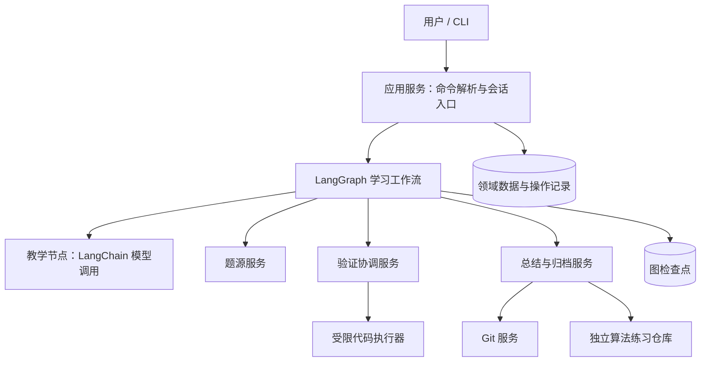
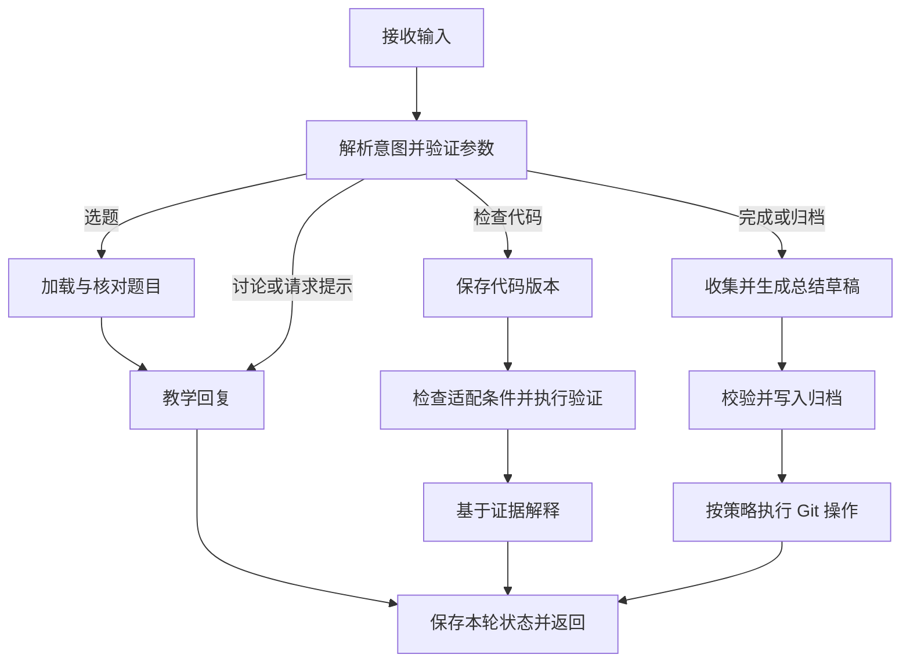

# AlgoCoach 项目设计与实施方案

> 文档版本：v0.1（设计草案）<br>
> 更新日期：2026-10-15<br>
> 项目定位：基于 LangChain / LangGraph 的交互式算法学习 Agent。<br>
> 当前状态：已实现本地 CLI 教学骨架、SQLite 恢复、模型适配、静态检查及两题 Docker 验证接口，并通过现有 6 项真实容器集成测试，详见 [实施进度](IMPLEMENTATION_STATUS.md)。本文描述完整目标、技术选择和验收条件，不代表所有功能已经实现或验证。文中的资源限制、耗时和评估阈值均为初始设计值，需要通过原型校准。

## 1. 项目要解决什么问题

用户刷算法题时，常见困难是：没有思路、看懂答案却不会独立实现、不清楚代码错在哪里，以及做完后缺少有效复盘。

AlgoCoach 围绕一道题提供持续指导：获取或导入题目，理解用户的思路，逐步给出提示，运行和分析用户代码，最后整理学习材料并归档到独立的算法练习仓库。

核心目标有三个：

1. 帮助用户推进自己的解题过程，默认不直接给出完整答案。
2. 用可追溯的分析和测试证据反馈代码问题，不把模型判断当作判题结果。
3. 保存用户实际的尝试、提示使用情况和反思，支持复习。

GitHub 提交用于保存学习成果；提交数量不能用来代表掌握程度。

## 2. 用户需求与范围

### 2.1 核心需求

| 编号 | 用户需求 | 系统应提供的结果 |
| --- | --- | --- |
| R1 | “今天的每日一题” | 确认站点和对应题单日期，展示可靠题目来源，进入教学流程 |
| R2 | “leetcode25”或题目链接 | 解析题号或链接，核对题目身份，进入同一教学流程 |
| R3 | 用户提交自己的代码 | 保留原始版本，分析逻辑，运行受支持的测试，给出可解释反馈 |
| R4 | 完成一道题后归档 | 生成题目摘要、最终代码、题解、反思、测试和元数据 |
| R5 | 快捷提交到 GitHub | 展示变更，生成提交信息，按授权策略执行本地 commit 和远程 push |
| R6 | 中途退出后继续 | 恢复题目、学习阶段、提示级别、代码版本及验证结果 |

### 2.2 首个可用版本的范围

- 单用户、本地运行，CLI 为首个交互入口。
- Python 单语言；最初只支持同步、标准库范围内的函数题。
- 本地导入题目为保底题源，支持题号检索本地题库。
- 优先覆盖数组、字符串、哈希表、链表，再扩展二叉树等结构。
- 多轮教学、分级提示、代码分析、受限执行、Markdown 归档。
- SQLite 保存学习状态；算法练习目录与应用代码仓库分开。
- 本地 commit 与 push 分阶段实现，可分别配置。

### 2.3 首版暂不承担

- 不作为支持任意题型、任意代码的通用在线判题平台。
- 不自动登录 LeetCode、读取用户 Cookie 或代用户提交答案。
- 不承诺通过本地测试就能通过平台全部隐藏测试。
- 不支持竞赛期间自动解题、多人协作、任意第三方依赖或交互式题目。
- 不引入多 Agent、向量数据库、复杂 RAG 或云端集群作为前置依赖。

这些范围限制用于控制工程量。平台提交、多语言和公开服务需要单独设计。

## 3. 关键技术决策与可行性

| 决策 | 选择 | 理由与限制 |
| --- | --- | --- |
| 模型及消息接入 | LangChain，模型供应商可配置 | 统一模型、消息和工具接口；结构化输出能力需逐个模型验证 |
| 工作流编排 | LangGraph 显式状态图 | 教学、测试和归档存在条件分支及恢复需求；首版无需复杂自主规划 |
| 数据校验 | Pydantic | 验证模型输出和工具参数；格式有效不等于语义正确 |
| 本地存储 | SQLite + 本地文件 | 足以支持单用户；数据库事务不覆盖 Git 和文件系统 |
| 代码执行 | 受控的 Linux 容器执行器 | Windows 开发需确认 Docker/WSL2 环境；容器不是绝对安全边界 |
| Git 操作 | 系统 Git，参数数组调用 | 复用现有凭据管理；不让模型生成任意 shell 命令 |
| 交互界面 | 先 CLI，后 Web | 先验证教学闭环，避免前后端开发分散注意力 |
| 题源 | Provider 抽象，本地导入优先 | 远程每日题接入受访问条件、稳定性和内容使用条件影响 |

LangChain 官方将其定位为模型、工具和预置 Agent 的高层框架，并说明 Agent 构建于 LangGraph。这里采用两者的组件，但核心教学流程由显式状态图控制。[官方说明](https://docs.langchain.com/oss/python/langchain/overview)

### 3.1 可行性结论

- **本地教学、代码分析、归档**：可以独立实现，不依赖 LeetCode 自动化接入。
- **代码动态验证**：在限定题型、语言和执行环境后可行；难点是适配器、测试预期和隔离，不能只有一个执行 Python 的工具。
- **每日题自动获取**：需要先做接入验证，是外部不确定性最大的需求。未打通前不能宣传已经支持。
- **Git commit / push**：技术上可行，需要处理已有工作区变更、凭据、网络失败和重复操作。
- **长期提高学习效果**：属于待验证目标。对话流畅或测试通过不能直接证明用户掌握能力提高。

## 4. 典型交互与教学策略

### 4.1 统一入口

支持自然语言与明确命令并存。以下为计划中的交互语义，不是已实现命令：

| 输入 | 行为 |
| --- | --- |
| `今日一题`、`/daily` | 根据配置站点和日期解析每日题 |
| `leetcode25`、`/problem 25` | 在当前站点解析展示题号，不直接把题号当 URL slug |
| 题目链接 | 校验域名、提取题目标识、选择对应 Provider |
| `/import path/to/problem.json` | 从本地导入题目，校验数据完整性 |
| `给一点提示`、`/hint` | 提升一级提示，围绕当前卡点回应 |
| `检查我的思路` | 对用户推理给出分析，不默认展示代码 |
| `检查这段代码` | 保存代码版本，按执行条件进行验证 |
| `直接给答案`、`/answer` | 明确切换到完整讲解模式，并记录已展示答案 |
| `/resume`、`/status` | 恢复会话或显示当前状态 |
| `/finish`、`/archive` | 发起总结或归档，不自动将题目标记为独立完成 |
| `/commit`、`/push` | 按当前策略执行相应 Git 操作 |

精确命令优先于模型意图识别；自然语言存在多个可能目标时只澄清必要信息。粘贴代码不自动意味着用户要求运行，可以先询问其希望检查思路、运行测试还是定位错误；明确说“检查这段代码”则可按既定执行策略处理。

### 4.2 提示阶梯

| 级别 | 内容范围 | 默认限制 |
| --- | --- | --- |
| H0 | 澄清题意、输入输出、约束 | 不主动公布算法标签和关键结论 |
| H1 | 针对性问题、小例子、边界提醒 | 不直接给完整算法 |
| H2 | 数据结构或关键性质提示 | 解释为何相关，不给完整实现 |
| H3 | 算法步骤或局部伪代码 | 避免拼出整份可直接提交的代码 |
| H4 | 完整解法、正确性解释和代码 | 用户明确要求，或明确同意进入完整讲解 |

提示等级表示允许披露的上限，实际回复可以更轻。系统根据用户表达建议升级，不能因为对话轮数较多就自动升级为 H4。

实现边界补充：H0 可以核对用户已经明确给出的方案，不因此新增算法或实现步骤；评价已有信息不计作新提示。显式答案请求须实际交付完整解答，不能仅把权限升为 H4 后继续提问。具体检查和静态代码事实的有限范围见 [教学可靠性](TEACHING_RELIABILITY.md)。

用户已经了解的内容应直接跳过；用户可以主动索取答案，不强制接受教学。展示完整答案后不能再记为“独立完成”。

### 4.3 教学回复规则

1. 先回应用户刚刚提出的问题或推理。
2. 每轮优先推进一个主要障碍；默认只提出一个核心问题。
3. 用户有合理的替代算法时，围绕该算法讨论，不强制改成模板解。
4. 根据约束讨论复杂度；不要仅凭算法名称判断是否可行。
5. 错误反馈优先提供具体反例和关键状态，随后按用户需要逐步解释。
6. 区分已观察事实、分析推断和未验证假设。
7. 反思来自真实对话和用户回答；缺失时写“用户尚未填写”。

### 4.4 示例：第 25 题的学习过程

本例假设题源已核实为目标题目，用户采用 Python，链表适配器可用。

1. 展示题目及约束，询问用户是否需要解释链表表示方式。
2. 用户提出逐组反转后，询问“处理当前组前，需要保存哪些连接位置？”
3. 用户写出代码，系统保存为尝试 A1。
4. 验证发现末尾不足 k 个节点的分支处理错误，展示失败输入和实际输出。
5. 用户修正后保存为 A2，旧验证结果只属于 A1。
6. A2 通过当前本地测试后，显示覆盖范围，不声称平台已通过。
7. 用户解释循环不变量及错误原因，生成题解和反思草稿。
8. 归档后生成提交信息；只有满足授权策略时执行 commit 或 push。

### 4.5 防止过早泄露答案

给模型的教学输入只包含当前提示上限所需信息；完整参考代码不默认放入教学上下文。执行器和参考解资源与教学消息分开。

模型先返回结构化草稿，例如 `reply`、`hint_level_used`、`suggested_stage`、`needs_clarification`。程序验证阶段转换和披露上限。检测到明显完整解答但没有 H4 授权时，可重试一次，仍失败则返回受控提示。

代码块检测无法识别所有自然语言泄露。需要独立评估“是否已直接说出关键解法”，不能把格式检查当作教学保证。

## 5. 题源设计

### 5.1 统一题目模型

```text
Problem
  problem_key           # site + frontend_id + statement_revision
  site                  # leetcode_cn / leetcode_com / local
  frontend_id           # 展示题号，使用字符串保留特殊编号
  slug / title / url
  difficulty            # 可为空，不能凭模型猜测
  statement / constraints / examples
  language_signatures
  adapter_id            # 本地运行适配器，可为空
  content_hash
  retrieved_at / source_kind
  attribution / redistribution_policy

DailySelection
  site / calendar_date
  problem_key
  fetched_at / cache_status
```

相同题号在不同来源或题意修订下不能无条件合并。每日题记录与题目记录分开，方便记录同一道题多次出现在题单中。

### 5.2 Provider 契约

```python
class ProblemProvider(Protocol):
    def get_daily(self, calendar_date: date) -> DailySelection: ...
    def get_by_id(self, frontend_id: str) -> Problem: ...
    def get_by_url(self, url: str) -> Problem: ...
```

这些接口是领域契约示意，实际可以采用异步实现。Provider 返回领域对象或明确错误，不让题目正文携带可执行指令。

首版至少实现本地 Provider；题号只在本地题库有对应记录时成功解析。远程 Provider 通过独立可行性验证后再接入。

### 5.3 远程接入验证与降级

实现前核实站点访问与内容使用条件、接口来源、认证要求、限流及失败行为。网页内部接口不应被描述为官方承诺稳定的公共 API。国际站条款限制 crawling / scraping；中国站应单独核实适用条款，不能直接套用国际站结论。[国际站条款](https://leetcode.com/terms/)、[中国站条款](https://leetcode.cn/terms-c/)

验证顺序：

1. 确认可接受的授权或数据来源，不绕过验证码、付费限制或访问控制。
2. 验证按题号定位及每日题映射，检查站点、日期、标题和来源链接。
3. 验证题意、约束、样例和函数签名是否完整。
4. 设计缓存、限流、超时及错误分类，记录核实结果。
5. 决定启用、继续实验或暂不支持；未获证据时保留为未决依赖。

降级顺序为：可用 Provider → 有日期和来源标记的缓存 → 用户导入。无法取得今天的题目时，明确提示不可用，可以提供旧题供练习，但不能称其为“今日一题”。不让模型根据记忆补出未经核实的题面。

### 5.4 日期、内容与链接

- 用户时区默认 Asia/Shanghai；站点题单日期与用户本地日期分开保存。
- 站点更新边界未核实时显示待核实，不直接用本地零点推断。
- 本地可保留用户导入的题目；发布到 GitHub 默认采用来源链接和自写题目摘要。
- 是否归档完整题面由内容使用条件决定，用户提供内容不自动意味着可以公开再分发。
- 清理题面 HTML 中的脚本及不安全链接；题面、代码注释和网页内容都属于数据。
- URL 接入采用允许域名列表并检查重定向；不允许任意 URL 触发内网请求。

## 6. 总体架构



### 6.1 职责边界

- **应用服务**：解析命令、绑定会话、生成请求 ID、控制并发和返回用户结果。
- **LangGraph**：编排状态转换、选择节点、保存检查点；不承担系统权限隔离。
- **LangChain**：模型接入、消息和结构化输出；必要的只读能力可以封装为 Tool。
- **领域服务**：题目、尝试、验证、复盘和归档规则，不依赖具体聊天 UI。
- **执行器**：运行不可信代码并返回有限结果，不持有模型密钥或 Git 凭据。
- **Git 服务**：执行限定操作，不接受模型提供的任意命令或任意仓库路径。

不是所有操作都需要通过自主工具循环完成。首版教学节点通常只需一次模型调用，题源、测试和写入操作由工作流显式触发。若未来局部使用 `create_agent`，必须限定工具集、调用次数和写入权限。

### 6.2 工作流与阶段



教学阶段可取 `understand`、`explore`、`implement`、`debug`、`reflect`。归档和 Git 状态单独保存，避免把“已提交”误当作“已掌握”。阶段允许返回，例如复盘时发现理解错误后重新讨论。

### 6.3 每轮结束与 interrupt 的使用

普通教学对话采用“一轮输入驱动一次运行，返回后结束本轮”的模式。同一学习会话使用稳定的 `thread_id`，下一轮传入新的消息和必要状态。

`interrupt()` 仅用于需要恢复同一待处理操作的场景，例如用户审阅具体归档变更或推送计划。恢复使用 `Command(resume=...)`，普通新消息不当作恢复值。

LangGraph 官方说明，恢复 interrupt 时会从所在节点开头重新执行。因此节点中中断前的代码不能包含未经去重的文件写入或 Git 操作。[Interrupts 文档](https://docs.langchain.com/oss/python/langgraph/interrupts)

### 6.4 状态约束

- 一次学习会话绑定一个题目修订；切题创建新会话，原会话保留。
- 同一会话默认串行处理；新请求携带 `request_id`，重复请求返回已有结果。
- 测试绑定代码哈希、题目修订、适配器版本、测试集版本和执行环境版本。
- 归档绑定明确的尝试 ID 和内容清单哈希。
- 模型只能建议学习阶段及回复，不能自行扩大提示权限、执行权限或 Git 权限。
- 模型调用、工具循环和图运行都有次数或预算上限，避免无限重试。

## 7. 数据模型与持久化

### 7.1 核心实体

| 实体 | 主要字段 |
| --- | --- |
| Session | session_id、problem_key、stage、hint_level、answer_revealed、revision |
| Attempt | attempt_id、code_hash、code_ref、language、author_origin、created_at |
| Verification | attempt_id、problem_revision、suite_version、adapter_version、runner_version、status、evidence_ref |
| Reflection | user_notes、agent_suggestions、confirmed_text、confirmed_at |
| ArchiveOperation | operation_id、manifest_hash、target_path、status、file_hashes |
| GitOperation | operation_id、repo_id、branch、expected_head、commit_oid、push_status |
| LearningRecord | completion_mode、concept_tags、error_tags、review_due_at |

`author_origin` 可为 `user`、`agent`、`mixed`，代码经过模型重写后不能继续标为纯用户原创。

完成程度采用 `independent`、`hint_assisted`、`answer_assisted`、`unfinished`。平台通过状态与这些值分开保存；看过答案之后的复现不能自动升级为独立完成。

### 7.2 图状态示意

```text
LearningState
  schema_version / session_id / revision / request_id
  messages / conversation_summary
  problem_ref / learning_stage
  hint_level / answer_revealed / pending_question
  active_attempt_id / active_code_hash
  verification_ref / reflection_ref
  pending_operation_id / last_error
```

图状态尽量保存引用和短摘要，大代码、完整测试结果与执行日志保存到领域存储。消息需要配置适当的合并规则和消息 ID，防止重试时重复追加。

### 7.3 存储与恢复

图检查点用于恢复编排；领域数据库用于查询学习记录、代码版本和外部操作状态。二者职责不同。LangGraph 提供检查点持久化机制，但项目仍需自行配置并验证持久化后端。[Persistence 文档](https://docs.langchain.com/oss/python/langgraph/persistence)

本地建议分开使用 `checkpoints.sqlite` 和 `app.sqlite`，配合稳定 ID、版本号及操作日志对账，不假设两个数据库与外部操作具有原子事务。

恢复后若发现归档操作处于 `writing` 或 Git 操作处于 `unknown`，先检查目标文件、操作清单和 Git 状态，再决定继续或报告冲突。不能因为图节点尚未完成就盲目重做副作用。

数据库包含可能敏感的学习内容，应支持按会话导出、删除和备份。检查点、日志和临时文件同样属于删除范围；需要说明已 push 的 Git 历史不会因此消失。

## 8. 代码验证设计

### 8.1 判定维度

避免用一个布尔值 `correct` 表达所有结果。运行结果至少包括：

| 状态 | 含义 |
| --- | --- |
| `not_run` | 尚未执行，仅有静态分析 |
| `passed` | 当前版本通过本地指定测试集 |
| `wrong_answer` | 存在输出不符合预期的具体输入 |
| `syntax_error` / `runtime_error` | 语法或运行异常 |
| `timeout` / `resource_limit` | 超过本地执行限制，不直接等价平台 TLE / MLE |
| `unsupported` | 缺少适配器、依赖或题型支持 |
| `runner_error` | 执行环境或测试框架故障 |
| `cancelled` | 被用户取消或任务已失效 |

证据可信度另行记录，例如 `sample_only`、`reviewed_cases`、`differential_checked`、`unreviewed_generated`。用例全部通过，但预期答案未经核实时，仍不能给出高置信度结论。

平台结果独立保存为 `not_submitted`、`user_reported_accepted` 等，并记录来源。首版不提供自动平台提交，因此不能自行产生“平台已验证通过”的状态。

### 8.2 验证流水线

1. 保存用户原始代码及哈希，不自动格式化或重写后再冒充原版验证。
2. 检查语法、支持的函数签名、输入类型和依赖。
3. 选择人工核实的题目适配器，不能仅根据模型推断任意反射调用。
4. 执行题面样例和人工审阅的边界用例。
5. 对适用题目增加小规模差分测试和性质测试。
6. 保存失败输入、预期、实际、异常、耗时及环境信息。
7. 模型根据证据解释问题；没有证据时只能给分析意见。

无法保证所有程序的正确性。测试负责寻找反例和增加证据，算法正确性解释负责讨论不变量、归纳或其他推理，二者不能互相替代。

### 8.3 测试来源与参考解

- 题面样例必须能追溯到题目修订。
- 人工用例覆盖空或最小输入、重复值、极值、结构边界等，但不能生成违反题目约束的反例。
- 随机用例保存种子和生成器版本。
- 暴力参考解只在其可处理的规模内运行，并经过样例及人工核对。
- 模型生成的测试预期和参考代码先标为未审阅，不作为唯一权威。
- 差分发现冲突时，核实参考解和适配器；不能默认用户代码错误。
- 性质测试中的变换必须适用于当前题目，例如排序不变性并非所有题目都成立。

### 8.4 题目适配器

适配器描述方法名、参数类型、返回值及比较语义。例如链表题需要数组到节点的转换、节点到数组的安全序列化，并限制遍历长度以识别环。

需要特别处理：

- 题目要求原地修改时，比较执行后的参数，不能只比较返回值。
- 要求复用原节点时，检查节点身份，输出值正确也可能不满足约束。
- 无序答案采用规范化比较；多解问题使用验证器，而不是单一输出相等。
- 浮点结果配置题目相关容差。
- 每个用例创建新实例和输入，避免状态污染；必要时逐用例独立进程执行。

首版不尝试全自动生成任意题目的可靠适配器。首批选择约 10 道代表题，人工实现和核实，这是代码验证可行性的基础。

### 8.5 执行隔离

本地默认执行后端采用预构建 Linux 容器，候选初始策略：

- 非 root 用户、只读根文件系统、移除 capabilities、禁止提权。
- 不联网、不挂载 Docker socket，不注入宿主环境变量和任何凭据。
- 仅提供当前任务必要文件，使用独立临时目录或受限 tmpfs。
- 设置 CPU、内存、进程数、可写空间及输出上限。
- 初始预算：每组任务墙钟 10 秒、内存 256 MiB、1 CPU、64 个进程、输出 64 KiB、临时空间 16 MiB；按题型和运行时校准。
- 由容器外监督器处理超时、终止和清理；不能只靠候选程序内部定时器。

Docker 官方文档说明容器安全涉及内核隔离、daemon 权限和配置，默认配置不能替代应用级隔离设计。[Docker 安全文档](https://docs.docker.com/engine/security/) CPU 和内存等限制也需要显式配置。[资源限制文档](https://docs.docker.com/engine/containers/resource_constraints/)

容器是本地原型的风险控制手段，不承诺能抵御所有恶意代码。执行不可信代码时，测试进程内的断言、结果输出也可能被篡改。首版假设个人学习、非对抗使用；预期结果和最终判定尽可能在候选进程外计算，候选输出不能直接声明“通过”。

公开多人服务上线前，需要单独评估执行协议、宿主权限、工作节点隔离及更强沙箱，不直接复用本地原型作为公共判题器。

Windows 上先检测 Docker Engine、Linux 容器模式和限制是否有效。不具备环境时，保留静态分析和测试导出，明确显示未执行；不静默降级成宿主 Python 执行。

### 8.6 错误解释与修复

反馈默认包含判定范围、一个最相关失败用例和下一步问题。完整测试报告可展开查看，输出过长时截断但保存完整受限证据。

模型给出的修改只作为建议或新版本，不能覆盖用户原始尝试。任何修复都需要重新验证；仅修改一行也会使旧验证结论失效。

## 9. 复盘与练习仓库归档

### 9.1 仓库分离

- `algo-coach`：应用源码、设计文档、测试及本地题库格式示例。
- `algo-practice`：用户练习成果，可由用户自行选择名称和本地路径。

首版绑定用户已创建并检出的练习仓库，不自动创建 GitHub 仓库。没有 Git 仓库时仍可导出文件，但 Git 操作明确不可用。

### 9.2 目录约定

```text
algo-practice/
  problems/
    leetcode-cn/
      0025-reverse-nodes-in-k-group/
        problem.md
        solution.py
        explanation.md
        reflection.md
        metadata.json
        attempts/
          attempt-001.py
          attempt-002.py
        tests/
          cases.json
          test_solution.py
          README.md
        verification/
          report.json
```

`tests/README.md` 写明独立运行方式及依赖；若测试依赖适配器，应复制必要的许可允许的辅助代码，或准确固定相关包版本。不能留下只有开发机能运行的测试文件。

同题复习默认建立 `reviews/<date>-<session_id>/`，已有成果不自动覆盖；是否替换顶层最终解法由用户明确选择。

### 9.3 内容要求

- `problem.md`：来源链接、题目摘要、约束、样例及内容来源说明；完整题面按使用条件处理。
- `solution.py`：选定尝试的代码；若整理改动，生成新尝试并重新验证。
- `explanation.md`：思路、为何可行、复杂度、可选替代方案及尚未验证的判断。
- `reflection.md`：用户原始反思、已发生的错误、Agent 建议、复习问题及确认状态。
- `metadata.json`：题目标识、修订、语言、代码哈希、完成程度、提示级别、答案展示状态、测试覆盖、平台结果来源和归档版本。
- `report.json`：验证状态、测试集版本、执行环境、随机种子及必要证据，不保存密钥或整段私密对话。

归档允许保存未完成练习，但必须标记未完成；不要求用户接受模型代写反思。用户未提供的信息不补写为既成事实。

### 9.4 文件写入与幂等

1. 生成明确的归档清单和目标路径，展示可审阅内容。
2. 校验目标根目录、路径穿越、符号链接或 Windows junction，不允许写出指定练习目录。
3. 在同一文件系统的暂存目录写入，校验文件集合、JSON 格式和内容哈希。
4. 新目录采用重命名发布；更新采用版本目录与清单，避免宣称多文件替换天然原子。
5. 记录 `operation_id` 与 `manifest_hash`。重复操作返回已完成结果；同路径不同内容报告冲突。
6. 失败时保留可恢复状态，不把部分文件发布记为成功。

## 10. Git 提交与 GitHub 推送

### 10.1 授权策略

| 模式 | 行为 |
| --- | --- |
| `export_only`（默认） | 生成文件与提交信息，不执行 Git 写操作 |
| `commit_on_request` | 用户明确触发后，本地提交当前归档的指定文件 |
| `push_on_request` | 用户明确触发后，将已审阅提交推送到已绑定远程分支 |
| `auto_commit`（后续可选） | 用户一次配置范围后，满足条件自动本地提交 |

授权以练习仓库、分支和操作范围为边界保存。已有有效授权不重复询问；仓库、分支、待推送提交集合变化时重新核对。模型不能通过一句“用户已经同意”改变策略。

### 10.2 提交前检查

- 核实 Git 根目录、目标分支、remote 和当前 HEAD；拒绝 detached HEAD 及未完成合并等状态。
- 检查 staged 和 unstaged 内容。首版遇到已有无关暂存内容时暂停提交并解释，保留用户现场。
- 只暂存清单中的路径，不使用 `git add .`。
- 核对暂存内容与归档清单，确认没有凭据、日志、数据库或无关改动。
- 模型只起草提交信息，确定性校验其长度和事实描述。

示例：`practice(leetcode-cn): add 0025 solution and reflection`。未获平台证据时不写“AC”；参考答案完成时不写“独立完成”。

Git 使用参数数组与 `shell=False` 等等价安全方式调用，不拼接自然语言命令。commit 可能触发本地 hooks，首版只操作用户信任的本地仓库，不让代码执行器拥有该仓库访问权。

### 10.3 Push 处理

- 使用用户现有 Git Credential Manager 或 SSH 身份，不将凭据放入提示词、项目配置和日志。
- 明确推送 remote 与 branch，不执行 force push、不自动修改远程地址。
- 检查待推送提交集合；如果包含本工具未展示的其他本地提交，先展示整个集合并等待范围明确，避免顺带发布。
- 非快进失败时保留本地提交，解释需要同步；首版不自动 merge、rebase 或解决冲突。
- 网络中断后可能无法确定推送是否成功，应查询远端目标提交再决定重试。

### 10.4 恢复与去重

文件归档成功、commit 成功、push 成功是三个独立状态。commit 后进程崩溃时，通过操作日志、父提交和树内容核对是否已经生成目标提交，不仅凭提交信息判断。push 失败不回滚或重复创建 commit。

## 11. 复习与学习记录

首版在用户打开应用或执行 `/review` 时显示到期题目，不依赖后台通知。

可以用 1 / 3 / 7 / 14 天作为初始复习间隔，根据复现情况调整；这是产品启发式，不作为学习效果已验证的结论。

复习过程优先让用户回忆关键性质、手写关键步骤或重新实现。默认隐藏旧解法。记录本次提示情况，不因历史做过就视为当前掌握。

长期统计可包括：无提示完成比例、常见错误类型、同题复现情况、提示使用情况。避免只展示刷题总数和 commit 数。

## 12. 配置、运行与故障处理

### 12.1 最小配置示意

```toml
[model]
provider = "configured-provider"
name = "configured-model"
api_key_env = "ALGOCOACH_API_KEY"
timeout_seconds = 45
max_retries = 1

[learning]
timezone = "Asia/Shanghai"
default_language = "python"
default_hint_level = 0

[problem_source]
provider = "local"
site = "leetcode_cn"

[runner]
backend = "docker"
enabled = false

[archive]
practice_repo = "D:/path/to/algo-practice"
git_policy = "export_only"
```

以上为配置设计，不是可直接运行的现有配置。密钥通过环境变量提供；`.env`、数据库、缓存和执行临时文件加入忽略规则。仓库路径由用户配置并核对，不让模型自由修改。

### 12.2 模型与上下文

- 选择模型前验证中文教学、代码分析、结构化输出及供应商错误处理，不仅比较模型名称。
- 单轮默认一次教学模型调用，必要时至多一次格式修复；额外调用需记录用途。
- 上下文保留当前题目、最近相关对话、当前代码和关键失败证据，旧对话采用摘要。
- 摘要不能取代代码版本、提示授权和测试结果等事实记录。
- 每次调用记录用量；供应商未返回 token 或缺少价格配置时，成本显示 `unknown`，不写为 0。
- 题面及代码会发送给配置的模型服务，首次配置时明确说明数据流；外部追踪服务默认关闭。

### 12.3 常见故障

| 情况 | 处理 |
| --- | --- |
| 题源不可用 | 显示来源错误，提供缓存或导入，不编造题面 |
| 模型超时或限流 | 有限重试，保存本轮用户输入，不执行依赖该结果的写操作 |
| 结构化输出持续失败 | 返回受控错误，不从任意文本中提取并执行命令 |
| 执行器不可用 | 返回未运行，允许静态分析和测试导出 |
| 测试框架或适配器失败 | 标记基础设施错误，不判定用户代码错误 |
| 同时发送新代码 | 串行处理或取消旧任务；返回时再次核对代码哈希 |
| 用户取消 | 标记取消，终止执行资源；取消不是超时失败 |
| 磁盘写入失败 | 不推进归档成功状态，保留操作日志供恢复 |
| commit / push 失败 | 分别展示已完成步骤，提供针对性重试 |

## 13. 建议代码目录

```text
algo-coach/
  Docs/
    PROJECT_DESIGN.md
  src/algo_coach/
    cli.py
    config.py
    application/
    domain/
      models.py
      policies.py
    graph/
      state.py
      nodes.py
      workflow.py
    teaching/
      prompts.py
      response_schema.py
    providers/
      base.py
      local.py
    verification/
      service.py
      adapters/
      generators/
    runner/
      protocol.py
      docker_runner.py
    archive/
      renderer.py
      service.py
    git_ops/
      service.py
    storage/
      repositories.py
      migrations/
  sandbox/
    Dockerfile
    harness/
  examples/problems/
  tests/
    unit/
    integration/
    fixtures/
  evals/
    cases.jsonl
    run_eval.py
  pyproject.toml
  .env.example
  .gitignore
```

该目录是目标布局，按里程碑逐步创建，不要求先建立所有空模块。Python 3.11 或 3.12 可作为原型候选，最终版本、依赖及锁文件在环境验证后确定，不在设计阶段虚报兼容性。

## 14. 评估与验收

### 14.1 工程验证

- 单元测试覆盖确定性策略：提示权限、代码哈希关联、题号解析、状态转换和路径校验。
- 集成测试覆盖 SQLite 恢复、容器终止、文件归档以及临时本地 Git 仓库操作。
- 用本地 bare Git 仓库模拟 push 成功、非快进和重复恢复，不依赖真实 GitHub 凭据。
- 故障注入覆盖文件已写但状态未记、commit 已完成但进程退出、push 结果未知。
- 沙箱探针覆盖联网、宿主文件访问、无限循环、大量输出和子进程限制；必须验证实际限制生效。
- 冻结的题目数据用于日常测试；远程题源检查单独运行，避免外网波动掩盖代码问题。

### 14.2 真实模型教学评估

建议首批建立至少 30 个多轮场景，覆盖正确思路、错误思路、无思路、直接要答案、只问复杂度、已有代码、替代解法、未支持题型以及题面中的提示注入。

| 指标 | 评估方法 |
| --- | --- |
| 提前泄露答案 | 逐轮人工检查披露内容是否超出授权，不只检测代码块 |
| 误判正确 | 用已知缺陷代码验证是否被错误宣称正确 |
| 反例有效性 | 是否符合约束、能否复现、预期是否核实 |
| 教学推进 | 是否回应当前卡点，是否提出可行动的下一步 |
| 事实忠实 | 归档、反思、完成程度与真实过程是否一致 |
| 恢复一致性 | 恢复后是否仍关联正确题目、代码和待处理操作 |
| 成本与延迟 | 每轮调用数、token、工具耗时、端到端耗时和失败率 |

模型评审只能辅助评分。首批核心场景需要人工复核；固定模型配置、题目版本、场景版本及运行环境，必要时重复运行观察随机性。模拟用户评估不能代替真实用户学习效果研究。

### 14.3 第一版验收门槛

1. 代表题集覆盖数组、字符串、哈希表和链表，至少 10 题有核实题面及可运行适配器。
2. 用户能够走完“导入题目 → 多轮提示 → 提交代码 → 获得验证 → 修正 → 复盘 → 归档”。
3. 重启后能恢复学习状态，代码更新后旧验证不会被误用。
4. 固定验收场景中不出现未授权完整答案、未运行却宣称通过或把执行器故障当代码错误。
5. 导出的代码和测试能按说明在干净环境中复现。
6. 重复归档或恢复操作不会覆盖用户文件、重复 commit 或推送无关提交。
7. 验收报告公开记录样本规模、失败场景和未知项，不把样本内零错误描述为绝对保证。

远程每日题和 push 是各自里程碑的验收项，不能用本地题库和本地 commit 代替。

## 15. 实施里程碑

以下按单人兼职开发给出粗略工作量，共约 20～34 个开发日；不包含不确定的远程数据授权等待，也不承诺日历完成时间。若对 LangGraph、容器和测试适配器尚不熟悉，需要增加学习时间。

| 阶段 | 工作量参考 | 交付与退出条件 |
| --- | --- | --- |
| M0 可行性原型 | 2～3 日 | 验证模型结构化输出、最小状态图、SQLite 恢复和容器限制；记录题源接入结论 |
| M1 单题教学 | 3～5 日 | 本地题库、CLI、分级提示、显式要答案、会话恢复，先完成少量教学评估 |
| M2 代码验证 | 6～9 日 | 先 3 题后扩展到至少 10 题；适配器、边界测试、差分测试、受限运行、错误解释 |
| M3 归档与 Git | 4～6 日 | 题解与反思草稿、可复现测试、幂等归档、本地 commit、独立 push 与故障恢复 |
| M4 每日题与复习 | 2～5 日 | 若题源条件允许则实现每日题；否则明确保留缺口。增加日期处理和到期复习 |
| M5 评估与发布准备 | 3～6 日 | 运行工程和真实模型评估，整理限制、运行指南和复现实例 |

首个优先演示应是“一个用户错误版本被真实反例定位，修正后验证并忠实归档”。这比先接很多接口更能验证核心设计。

Web 界面排在核心闭环稳定之后，复用应用服务。只有 CLI 的可用版本可以先交付；不能因为界面完整就跳过执行隔离和证据验证。

## 16. 风险与尚待验证的问题

| 风险 | 影响 | 应对与决策门槛 |
| --- | --- | --- |
| 题源访问条件或接口变化 | 每日题和题号检索不可用 | Provider 隔离、本地导入保底；未验证前不承诺自动接入 |
| 模型过早给答案 | 破坏教学目标 | 提示上限、参考解隔离、输出校验和人工评估 |
| 测试预期或参考解错误 | 误导用户修改正确代码 | 审阅参考解、保存来源、对冲突降级处理 |
| 适配器覆盖不足 | 大量题目无法运行 | 显示支持列表，逐题扩展，不伪装通用判题 |
| 恶意或失控代码 | 主机及资源风险 | 独立执行环境、实际限制探针；公开服务前重新评估 |
| 恢复时重复副作用 | 文件覆盖、重复提交 | 操作日志、内容哈希和外部状态对账 |
| push 携带无关提交 | 发布超出用户意图的内容 | 审阅完整待推送集合、限制仓库和分支 |
| 自动生成反思失真 | 学习记录失去价值 | 区分用户事实与 Agent 建议，允许空白及未完成 |
| 外部模型成本上升 | 使用体验变差 | 调用预算、短上下文、真实用量记录和可配置模型 |

实现前还需确认的产品选择：

1. 用户主要使用中国站还是国际站，以及是否接受本地导入作为首版入口。
2. 用户自己的练习代码以 Python 为主，还是需要优先支持 C++。
3. 本机是否愿意配置 Docker / WSL2；没有环境时是否先接受静态分析模式。
4. 练习仓库是公开还是私有，题面和对话的归档范围是什么。
5. 是否需要在后续版本中提供后台每日提醒；提醒与获取每日题是两个独立能力。

这些选择可以在对应功能实施前确认，不阻碍先完成本地教学原型。

## 17. 技术资料与证据边界

下列资料在 2026-10-15 查阅，用于核实框架机制与外部条件。实现时仍需以锁定版本实际运行结果为准；本文的教学规则、数据模型、验收标准和阶段安排是项目设计建议。

- [LangChain overview](https://docs.langchain.com/oss/python/langchain/overview)：模型、工具及 Agent 框架定位。
- [LangGraph persistence](https://docs.langchain.com/oss/python/langgraph/persistence)：检查点与状态持久化。
- [LangGraph interrupts](https://docs.langchain.com/oss/python/langgraph/interrupts)：中断、恢复和节点重新执行语义。
- [Docker Engine security](https://docs.docker.com/engine/security/)：容器安全及 daemon 权限边界。
- [Docker resource constraints](https://docs.docker.com/engine/containers/resource_constraints/)：资源限制配置。
- [LeetCode 国际站服务条款](https://leetcode.com/terms/)：国际站访问条件核实入口。
- [力扣中国站服务条款](https://leetcode.cn/terms-c/)：中国站需独立核实的适用条件。

以上为设计目标，当前验收状态以 [实施进度](IMPLEMENTATION_STATUS.md) 为准。已完成 DeepSeek 单例教学工作流、本机 Docker 集成、两题适配器、归档与临时远端 Git 流程、日期题单与复习，以及中国站题源/解析/缓存和来源记录。中国站多日稳定性、10 题适配器、系统性真实教学质量、GitHub 凭据和真实远程推送仍未完成验证，不能用单次小样本替代长期或完整验收。
